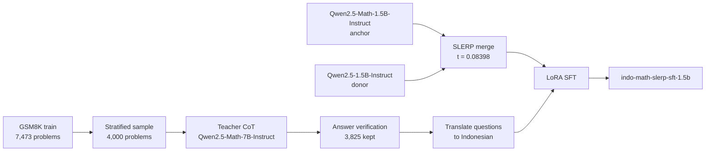

# Indo Math Reasoning SLM

**Enhancing Indonesian Mathematical Reasoning in Small Language Models through
Cross-Lingual Model Merging (SLERP) and LoRA-Based Supervised Fine-Tuning**

[](https://huggingface.co/rantetadung/indo-math-slerp-sft-1.5b)

This repository contains the code, data, and inference dashboard for the project.

## Overview

Small Language Models (SLMs) can run on modest hardware, but their math reasoning drops
sharply when problems are asked in a lower-resource language such as Indonesian. This
project measures that cross-lingual gap on GSM8K and narrows it with a two-stage pipeline:

1. **Cross-lingual model merging (SLERP).** Merge the math specialist
   `Qwen/Qwen2.5-Math-1.5B-Instruct` (anchor) with the general multilingual model
   `Qwen/Qwen2.5-1.5B-Instruct` (donor) at interpolation weight **t = 0.08398**.
2. **LoRA-based Supervised Fine-Tuning (CoT distillation).** Fine-tune the merged model on
   Indonesian questions paired with step-by-step English solutions generated by the
   teacher model `Qwen/Qwen2.5-Math-7B-Instruct`.

### Key results (GSM8K test set, 1,319 problems, pass@1)

| Model | English | Indonesian | Gap (pp) |
|---|---:|---:|---:|
| Qwen2.5-1.5B-Instruct (general) | 67.9% | 48.6% | 19.3 |
| Qwen2.5-Math-1.5B-Instruct (anchor) | 85.7% | 26.8% | 58.9 |
| + SLERP merge (t = 0.08398) | 84.69% | 45.49% | 39.20 |
| **+ LoRA SFT (final model)** | **84.46%** | **61.49%** | **22.97** |

- Indonesian accuracy rose from **26.8% to 61.49%** (+34.69 pp), beating both baselines.
- The cross-lingual gap shrank from **58.9 to 22.97 pp**.
- English accuracy stayed almost unchanged (85.7% to 84.46%).
- McNemar's test with Holm-Bonferroni correction: every Indonesian improvement is
  significant (p < 0.001); no English drop is significant.

## Model on Hugging Face

The final model (SLERP merge + LoRA SFT, merged into a single full model) is available at
**[rantetadung/indo-math-slerp-sft-1.5b](https://huggingface.co/rantetadung/indo-math-slerp-sft-1.5b)**.

The `model/` folder is not included in this GitHub repository because of its size (about 3 GB).
Download the model from Hugging Face into the folder used by the dashboard:

```bash
hf download rantetadung/indo-math-slerp-sft-1.5b --local-dir model/slerp_sft_model
```

(`hf` is installed together with `transformers`; if it is missing: `pip install -U huggingface_hub`.)

Or use it directly in Python without the dashboard. Use the same Indonesian system prompt
as in training and evaluation for best results:

```python
import torch
from transformers import AutoModelForCausalLM, AutoTokenizer

repo = "rantetadung/indo-math-slerp-sft-1.5b"
tokenizer = AutoTokenizer.from_pretrained(repo)
model = AutoModelForCausalLM.from_pretrained(repo, dtype=torch.bfloat16, device_map="cuda")

system_prompt = (
    "Anda adalah asisten penalaran matematika. Selesaikan soal dengan cermat "
    "secara bertahap. Pada baris terakhir, tuliskan hanya jawaban numerik akhir "
    "dengan format: \\boxed{nilai}"
)
question = "Budi memiliki 12 kelereng. Ia memberikan 5 kelereng kepada Ani, lalu membeli 8 kelereng lagi. Berapa kelereng Budi sekarang?"

messages = [{"role": "system", "content": system_prompt},
            {"role": "user", "content": question}]
prompt = tokenizer.apply_chat_template(messages, tokenize=False, add_generation_prompt=True)
inputs = tokenizer(prompt, return_tensors="pt").to(model.device)
output = model.generate(**inputs, max_new_tokens=1024, do_sample=False)
print(tokenizer.decode(output[0][inputs["input_ids"].shape[1]:], skip_special_tokens=True))
```

The model reads Indonesian questions and reasons in English (cross-lingual CoT), ending with
`\boxed{answer}`. It needs about 3.5 GB of VRAM in bfloat16.

## Method



### 1. Dataset preparation

- **Source:** GSM8K (`openai/gsm8k`, config `main`): 7,473 train and 1,319 test problems.
- **Complexity strata** from the number of reasoning steps in the reference solution:
  L1 (≤ 3 steps), L2 (4-5 steps), L3 (≥ 6 steps). The test set has 697 / 472 / 150
  problems per stratum.
- **SFT candidates:** 4,000 train problems by proportional stratified sampling
  (`random_state=42`): 2,200 L1, 1,399 L2, 401 L3.
- **Teacher CoT:** `Qwen2.5-Math-7B-Instruct`, greedy decoding, bfloat16, max 1,024 new
  tokens, answers in `\boxed{}` (black-box knowledge distillation).
- **Answer verification:** only CoTs whose extracted answer matches the ground truth were
  kept: **3,825 of 4,000 (95.6%)**, i.e. L1 2,141, L2 1,326, L3 358.
- **SLERP search subset:** 210 separate train problems (70 per stratum), checked to have no
  overlap with the SFT data or the test set.

### 2. Translation to Indonesian

- Questions were translated with Gemini 3.1 Pro Preview in batches of at most 50, returned
  as JSON.
- Test set and SLERP subset: question only. SFT data: Indonesian question + English CoT
  (cross-lingual scheme following XCOT).
- All 1,319 test and 3,825 train translations were quality-checked on two 1-5 Likert
  scales, **Fluency** and **Change of Meaning**, adapted from the MATH-IDN study.

### 3. Baseline evaluation

Both 1.5B models were evaluated on all 1,319 test problems in English and Indonesian with
bfloat16, greedy decoding (`num_beams=1`), max 1,024 new tokens, and batch size 16.
Answers are extracted from `\boxed{}` with a last-number fallback, then normalized
(currency symbols and thousands separators removed).

### 4. SLERP model merging

- Toolkit: **mergekit**, method SLERP, anchor `Qwen2.5-Math-1.5B-Instruct`, donor
  `Qwen2.5-1.5B-Instruct`, dtype bfloat16.
- The interpolation weight `t` was tuned with **Optuna (TPE sampler)** over the range
  0.075-0.09: 20 trials, 5 random start-up trials, maximizing exact-match accuracy on the
  210-problem Indonesian search subset.
- Best value: **t = 0.08398**.

```yaml
merge_method: slerp
base_model: Qwen/Qwen2.5-Math-1.5B-Instruct
models:
  - model: Qwen/Qwen2.5-Math-1.5B-Instruct
  - model: Qwen/Qwen2.5-1.5B-Instruct
parameters:
  t: 0.08398
dtype: bfloat16
```

### 5. LoRA supervised fine-tuning

- 3,825 examples split 90/10 into 3,442 train and 383 validation (`random_state=42`).
  No overlap with the test set was found.
- Format: Qwen2.5 chat template with system prompt, Indonesian question, and English CoT
  response. Loss is computed on the response only (`train_on_responses_only`).
- Trained with **Unsloth** in full bfloat16 (no quantization).

| LoRA | Value | Training | Value |
|---|---|---|---|
| Rank (r) | 16 | Epochs | 2 |
| Alpha | 32 | Batch size (per device × grad. accum.) | 8 × 4 = 32 |
| Dropout | 0.05 | Learning rate | 3 × 10⁻⁵, cosine, warmup ratio 0.1 |
| Scheme | rsLoRA | Optimizer | AdamW 8-bit, weight decay 0.01 |
| Target modules | q, k, v, o, gate, up, down proj | Max grad norm | 1.0 |
| Bias | none | Best model | lowest `eval_loss` |
| Gradient checkpointing | Unsloth | Early stopping | patience 6, threshold 0.001 |

Eval loss fell steadily from 0.2210 to 0.1862 by the end of epoch 2 with no sign of
overfitting.

### System prompts

| Name | Used for | Prompt |
|---|---|---|
| `SYSTEM_PROMPT_EN` | English evaluation | You are a mathematical reasoning assistant. Solve the problem carefully, step by step. On the final line, write only the final numerical answer in this format: `\boxed{value}` |
| `SYSTEM_PROMPT_ID` | Indonesian evaluation and SFT data | Anda adalah asisten penalaran matematika. Selesaikan soal dengan cermat secara bertahap. Pada baris terakhir, tuliskan hanya jawaban numerik akhir dengan format: `\boxed{nilai}` |

## Detailed results

### Accuracy per complexity stratum

| Model | Language | L1 | L2 | L3 |
|---|---|---:|---:|---:|
| Qwen2.5-1.5B-Instruct | EN | 74.5% | 62.9% | 53.3% |
| | ID | 55.5% | 43.6% | 32.0% |
| Qwen2.5-Math-1.5B-Instruct | EN | 89.5% | 84.1% | 72.7% |
| | ID | 32.6% | 21.4% | 16.7% |
| SLERP merge | EN | 89.0% | 82.2% | 72.7% |
| | ID | 53.9% | 37.5% | 31.3% |
| **SLERP + SFT (final)** | EN | 89.53% | 80.93% | 72.00% |
| | ID | **69.58%** | **55.51%** | **42.67%** |

Indonesian L3 (long reasoning chains) remains the weakest area of the final model.

### McNemar's test (Holm-Bonferroni corrected, α = 0.05)

`b` = correct → wrong, `c` = wrong → correct.

| Comparison | Language | b | c | χ² | p-value | Significant |
|---|---|---:|---:|---:|---:|---|
| Baseline → SLERP | ID | 79 | 326 | 149.42 | 4.64e-34 | Yes |
| SLERP → SFT | ID | 108 | 319 | 103.28 | 2.91e-24 | Yes |
| Baseline → SFT | ID | 60 | 518 | 361.33 | 4.34e-80 | Yes |
| Baseline → SLERP | EN | 68 | 55 | 1.17 | 0.5751 | No |
| SLERP → SFT | EN | 62 | 59 | 0.03 | 0.8557 | No |
| Baseline → SFT | EN | 74 | 58 | 1.70 | 0.5751 | No |

### Main findings

- **Math specialization makes small models fragile across languages.** At 1.5B, the math
  model loses 58.9 pp in Indonesian, three times the general model's drop. This is the
  opposite of the 7-8B pattern reported by MATH-IDN.
- **A small SLERP donor share is enough to recover Indonesian.** With t ≈ 0.084, SLERP
  lifted Indonesian accuracy by 18.69 pp and cut the gap by 33.4% at a 1.01 pp English
  cost. Weight analysis shows the change is concentrated in the embedding and LM head
  (cosine similarity 0.9821), while attention and MLP blocks stay at 0.9913-0.9980.
- **CoT distillation closes most of the remaining gap.** SFT added another 16.00 pp in
  Indonesian and cut the remaining gap by 41.4%.

## Inference dashboard

A FastAPI dashboard (HTML/CSS/JS frontend) runs the final model locally. It has an input
panel with L1/L2/L3 example problems, an output panel with the extracted answer and the
full chain of thought, session statistics, and a history of the last 10 queries.

### Running the dashboard

```bash
python -m venv .venv
.venv\Scripts\activate          # Windows

# Install the CUDA build of PyTorch first (REQUIRED to run on GPU).
# This project uses torch 2.8.0 built for CUDA 12.9.
# (torchvision/torchaudio are not needed)
pip install torch==2.8.0 --index-url https://download.pytorch.org/whl/cu129
pip install -r requirements.txt

# check that the GPU is detected (should print True and the GPU name)
python -c "import torch; print(torch.cuda.is_available(), torch.cuda.get_device_name(0))"

# download the model from Hugging Face (one time, ~3 GB)
hf download rantetadung/indo-math-slerp-sft-1.5b --local-dir model/slerp_sft_model

# (optional) copy the settings file
copy .env.example .env

# run from the project folder
uvicorn main:app --host 0.0.0.0 --port 8000
# or: python main.py
```

Open http://localhost:8000. The model is loaded once at startup, so wait until the log shows
"Model siap digunakan." (model ready).

The model runs fully on the GPU (all layers in VRAM, no CPU/disk offload; bfloat16 when
supported, otherwise float16; about 3.5 GB of VRAM). It was developed and tested on an
NVIDIA GeForce RTX 3050 Laptop GPU (4 GB). The server refuses to start if CUDA is not
detected (`REQUIRE_GPU=true`). `GET /health` reports the GPU in use.

On Windows, if loading fails with `The paging file is too small (os error 1455)`, increase
the Windows paging file (virtual memory) and restart.

### API

- `GET /health` → `{status, device, gpu_name, model_loaded}`
- `POST /infer` with body `{"question": "..."}` → `{answer, chain_of_thought, model, elapsed_time, timestamp}`

## Creating the full slerp-sft model (optional)

This step is only needed if you have `model/slerp_model` and `model/lora_model`
and want to rebuild the merged model yourself. Otherwise, just download it from Hugging Face.

Merge the LoRA adapter into the SLERP model to produce a single full model (no PEFT needed):

```bash
python -m utils.merge_lora                 # output: model/slerp_sft_model
python -m utils.merge_lora --verify        # + test one question after merging
python -m utils.merge_lora --verify-only   # test an existing merged model
python -m utils.merge_lora --help          # other options (--dtype, --device, --gpu, --output, --overwrite)
```

If `model/slerp_sft_model` exists, the dashboard uses it automatically.
Set `USE_MERGED_MODEL=false` in `.env` to fall back to base model + adapter.

## Project structure

```
main.py                    FastAPI entry point ("/" page + static mount)
api/routes.py              GET /health and POST /infer endpoints
core/config.py             Settings (can be overridden via .env)
core/gpu.py                GPU checks and helpers
services/model_service.py  Model loading, generation, \boxed{} answer extraction
models/schemas.py          Request/response schemas (Pydantic)
templates/, static/        Dashboard frontend
utils/merge_lora.py        Merge the LoRA adapter into the SLERP model
model/                     (not in Git; download from Hugging Face)
  slerp_sft_model/         Full slerp-sft model (used by the dashboard)
  slerp_model/             SLERP merged model (optional, for re-merging)
  lora_model/              LoRA adapter from SFT (optional, for re-merging)
dataset/
  sft/sft_dataset.json             3,825 SFT examples (ID question + EN teacher CoT)
  test/GSM8K Test Set.json         1,319 test problems (EN + ID)
  slerp/val_tsearch_pool.xlsx      210-problem subset for the SLERP t search
notebooks/
  01_Dataset_Preparation_GSM8K.ipynb   Strata, sampling, teacher CoT, verification
  02_Baseline_Model_Evaluation.ipynb   Baseline EN/ID evaluation
  03_Model_Merging.ipynb               Optuna t search, SLERP merge, weight analysis
  04_Supervised_Fine_Tuning.ipynb      LoRA SFT, evaluation, McNemar tests
```

The experiments (merging, SFT, evaluation) were run on Google Colab with an NVIDIA L4
(22.5 GB) for merging and evaluation and an NVIDIA A100 (40 GB) for SFT.

## Limitations and future work

- Reasoning is in English; the evaluation set is a translation of GSM8K, not native
  Indonesian problems.
- Translation used a chat interface; an API with fixed decoding would be more reproducible.
- Future work: native Indonesian benchmarks (SNBT, UN, OSN), mechanistic analysis
  (CKA, layer-wise probing) of where Indonesian representations recover, and
  preference-based alignment (RLHF/DPO) for multi-step Indonesian reasoning.

## License

The model weights follow the Apache 2.0 license of the Qwen2.5 base models.
